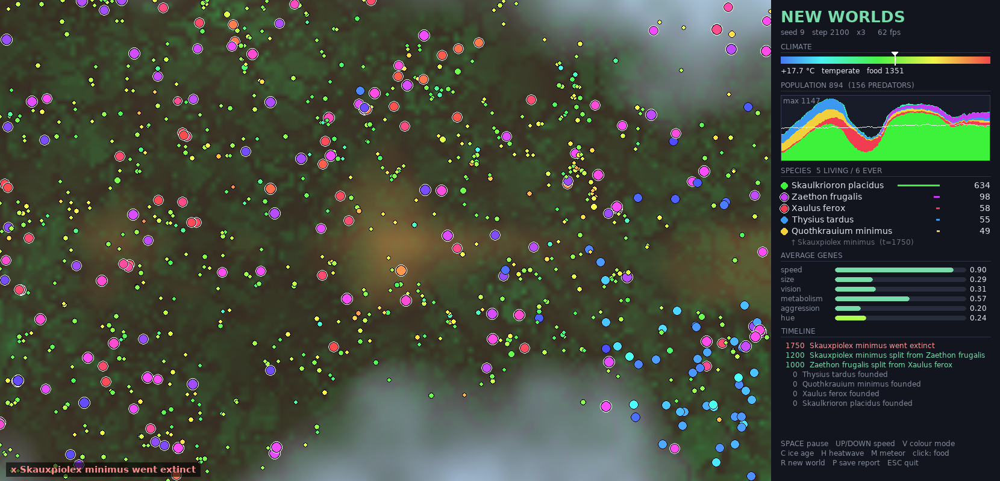

# New Worlds

**New Worlds is a living petri dish you can play god in.** Four founder species are dropped into a
procedurally generated planet: grazers, lumbering giants, far-sighted scouts and a pack of hunters.
Each creature has six genes (speed, size, vision, metabolism, aggression and colour), and every child
is a slightly mutated copy of its parent. Nobody scripts what happens next. Predator booms crash into
famines, prey evolve to outrun their hunters, and lineages drift apart until the clustering engine
recognises them as **new species**, gives each a name and colour, and adds a branch to the tree of
life. You can hit the planet with an ice age, a heatwave or a meteor and watch evolution respond
in real time. When you quit, you get a report with the population history and a phylogenetic tree
of every species that ever lived.



## Run it

```bash
pip install -r requirements.txt
python main.py                 # random world
python main.py --seed 42       # reproducible world
python main.py --cell 6        # smaller window for small screens (default 8 px per cell)
python main.py --headless --steps 5000 --seed 42   # no window: simulate, print, save report
pytest                         # tests
```

## Controls

| Key | Action |
|---|---|
| `Space` | pause / resume |
| `Up` / `Down` | simulation speed (1–20 steps per frame) |
| `C` | **ice age**: temperature drops, fertile land shrinks toward the equator |
| `H` | **heatwave**: temperature rises, the tropics turn to desert |
| `M` | **meteor strike** at the mouse cursor (or a random creature) |
| Left click / drag | drop food |
| `V` | colour creatures by gene hue or by detected species |
| `R` | reset with a new random seed |
| `P` | save a PNG report now (also saved automatically on exit) |
| `Esc` / `Q` | quit |

Reports go to `reports/`. Predators are drawn with a white ring.

## How it works

- **World** (`newworlds/world.py`): a 160×100 grid. A climate map (latitude plus fractal value noise)
  combined with the global temperature gives each cell a local temperature. Food grows back toward
  a cap that is highest where it is mild, so ice ages and heatwaves move the fertile belts around.
  Temperature follows a slow natural cycle and relaxes back after shocks.
- **Creatures** (`newworlds/creatures.py`): plain numpy arrays (structure of arrays), with no Python
  object per creature. Each step every creature samples food in 8 directions within its vision, uses
  a spatial hash to find neighbours, flees larger predators, chases smaller prey, then moves and
  eats. Moving costs energy in proportion to speed² × size. Predators only hunt when hungry, crowded
  hunters get in each other's way, and fast prey can outrun slow hunters. Together these keep
  predators and prey in balance instead of booming and crashing. Creatures die at 0 energy or of
  old age and split once they have enough energy. About 1% of births carry a large-effect mutation,
  so empty niches such as predation can be filled again. The population is capped at 1500.
- **Species** (`newworlds/species.py`): every 100 steps each species is split in two with k-means.
  If the halves are far apart in gene space and separated by a real gap, the smaller half becomes
  a daughter species. Its members adopt a new signal colour (the hue gene), so the split shows up
  on the map. Species that converge are merged, and empty ones are marked extinct. Names are
  generated: a genus plus a Latin epithet taken from the species' most distinctive trait
  (*velox*, *magnus*, *ferox*, …).
- **Rendering** (`newworlds/render.py`) is separate from the simulation, so it runs headless for tests
  and `--headless` runs. About 6 ms per frame for drawing and 3–5 ms per simulation step with
  1000–1500 creatures, which gives 35–60 FPS.
- **Report** (`newworlds/report.py`): a matplotlib stacked population chart with temperature and event
  markers, and a networkx phylogenetic tree (bar width = peak population, † = extinct).
